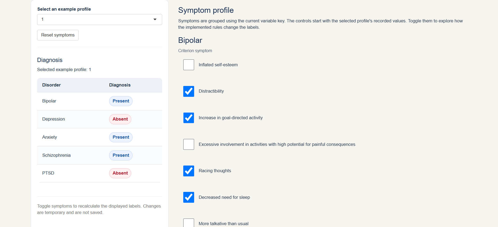

# PIPS Group Project

## Psychiatric Symptom Patterns and Diagnostic Classification

This repository contains a group project developed for the *Programming in Psychological Science* course at the University of Amsterdam.

The project investigates relationships between psychiatric symptoms and diagnostic classifications using a synthetic mental health dataset. It combines data preparation, rule-based diagnostic classification, statistical analyses, visualisations, independent function testing, and an interactive Shiny application.

**Disclaimer:** This project is intended exclusively for educational and programming purposes. It does not provide clinical diagnoses, and its findings should not be generalised to clinical populations.


## Interactive application preview



*Explore synthetic psychiatric symptom profiles, modify individual symptoms, and observe how predefined diagnostic classification rules respond. Changes can be reset and do not alter the original dataset.*

## Project objectives

The project addresses three research questions:

1. How are individual psychiatric symptoms associated with their corresponding diagnoses and with other diagnostic categories?
2. To what extent do different psychiatric diagnoses co-occur in the dataset?
3. How do symptom counts and predefined diagnostic thresholds influence classification outcomes?

The interactive Shiny application complements these analyses by allowing users to explore individual symptom profiles and their associated diagnostic classifications.

## Dataset

The project uses *Mental illness dataset*, a synthetic dataset obtained from Kaggle (Bakshi, n.d.).

**Dataset source:** [Mental illness dataset — Kaggle](https://www.kaggle.com/datasets/karanbakshi1/mental-illness-dataset)

The dataset contains 3,753 synthetic participant records and 58 binary variables representing 53 symptom and criterion indicators and five diagnostic classifications:

- Bipolar disorder
- Schizophrenia
- Depression
- Anxiety disorder
- Post-traumatic stress disorder (PTSD)

Variables are coded as `0` (absent) or `1` (present).

The original data are stored in `data/Mentalillness.csv`. A variable key, saved in `data/variable_key.csv`, maps the original column names to standardised short names and identifies the corresponding disorders and criteria.

The dataset's diagnostic classifications follow simplified DSM-style rules. Although these rules are inspired by psychiatric diagnostic criteria, they do not fully reproduce the clinical requirements described in the DSM-5 (American Psychiatric Association, 2013).

Consequently, the dataset is suitable for demonstrating statistical analysis, programming, and rule-based classification, but not for drawing clinical conclusions about actual psychiatric populations.

## Project components

### 1. Data preparation and validation

The project uses reusable R functions to load the dataset, standardise variable names, construct a variable key, and validate the binary indicators.

The validation procedures check for invalid values, missing observations, and nonexistent columns.

### 2. Diagnostic rule verification

Diagnostic labels are reconstructed from the symptom and criterion indicators using predefined classification rules.

The implementation includes:

- Reconstruction of all five diagnostic indicators.
- Comparison of reconstructed and original diagnostic classifications.
- Testing of selected diagnostic thresholds and boundary conditions.
- Verification of classification consistency across observations.

These procedures assess whether the R functions reproduce the dataset's rules correctly, rather than establishing the clinical validity of those rules.

### 3. Statistical analyses

The project investigates symptom–diagnosis associations, diagnostic co-occurrence, and symptom-count thresholds.

The analyses include:

- Chi-square tests of symptom–diagnosis associations.
- Phi coefficients as measures of association.
- False discovery rate (FDR) correction for multiple testing.
- Comparisons of observed and expected diagnostic co-occurrence.
- Analyses of the proportion classified with a diagnosis at different symptom counts.

The results are presented in the main report alongside statistical tables and visualisations.

### 4. Data visualisations

Three principal figures illustrate the findings:

- **Symptom–diagnosis heatmap:** Displays associations between individual symptoms and diagnostic categories.
- **Comorbidity plot:** Compares observed and expected co-occurrence frequencies for pairs of diagnoses.
- **Symptom-count plot:** Illustrates the relationship between symptom counts, diagnostic thresholds, and classification outcomes.

Generated figures are stored in `output/figures/`, while statistical result tables are saved in `output/tables/`.

### Interactive Shiny application

The project includes an interactive Shiny application implemented in `Shiny_Sim.Rmd`. It allows users to explore individual symptom profiles and investigate how modifying symptom indicators affects rule-based diagnostic classifications.
Users can select from 3,753 synthetic example profiles, examine symptom indicators grouped by disorder and criterion, and toggle individual symptoms to simulate alternative profiles. Diagnostic classifications are automatically recalculated using `apply_dsm_rules()` and the dataset's predefined thresholds.
The **Reset symptoms** button restores the selected profile's original symptom values and classifications. All modifications are temporary and do not alter the underlying dataset.
The application also provides expandable DSM-5 reference information, allowing users to compare the implemented classification rules with clinical diagnostic criteria. The dataset's simplified rules do not fully reproduce DSM-5 requirements.
**The application is intended solely for educational purposes and must not be used for clinical diagnosis.**

### 6. Independent function testing

The project includes an independent testing script, `tests/test_functions.R`, which verifies the behaviour of functions developed across the project.

Testing covers:

- Acceptance of valid binary data.
- Rejection of invalid values, missing observations, and nonexistent columns.
- Successful dataset loading and handling of invalid file paths.
- Variable-key completeness, structure, and uniqueness.
- DSM-rule output structure, classification consistency, and reproducibility.
- Sensitivity of diagnostic classifications to changes in symptom profiles.
- Shiny application input validation and successful application-object creation.

Independent testing also identified a missing-column validation issue in `check_binary()`. The function was updated to verify that requested columns exist before evaluating their values.

The tests were successfully executed after restarting R, helping verify that they do not depend on objects retained from previous interactive sessions.

## Repository structure

```text
PIPS-group-project/
├── data/
│   ├── Mentalillness.csv
│   └── variable_key.csv
├── src/
│   └── r/
│       ├── analyses.R
│       ├── functions_analysis.R
│       ├── functions_data.R
│       ├── functions_dsm_rules.R
│       ├── functions_variable_key.R
│       ├── plots.R
│       └── test_dsm_rules.R
├── tests/
│   └── test_functions.R
├── output/
│   ├── figures/
│   └── tables/
│       ├── comorbidity.csv
│       ├── count_vs_diagnosis.csv
│       └── symptom_associations.csv
├── main.Rmd
├── main.html
├── Shiny_Sim.Rmd
├── README.md
├── PIPS-group-project.Rproj
├── .gitignore
└── LICENSE
```

The project is organised into separate directories for source data, reusable functions, independent tests, and generated outputs.

`main.Rmd` is the main analytical report, while `main.html` is its rendered HTML version.

`Shiny_Sim.Rmd` contains the interactive Shiny application.

The directory structure should be maintained when downloading or cloning the repository, as the scripts use relative file paths.

## Getting started

### 1. Clone the repository

Clone the repository using Git:

```bash
git clone https://github.com/misia187/PIPS-group-project.git
```

Alternatively, select **Code → Download ZIP** on GitHub and extract the files.

### 2. Open the RStudio project

Open `PIPS-group-project.Rproj` in RStudio.

This makes it easier to work with the project files using their relative paths.

### 3. Install the required packages

The project uses R and the following packages:

- `dplyr` — Data manipulation.
- `ggplot2` — Statistical visualisation.
- `shiny` — Interactive application.
- `rmarkdown` — Rendering the HTML report.
- `knitr` — Executing and formatting R Markdown output.

Install the packages in the R Console:

```r
install.packages(c(
  "dplyr",
  "ggplot2",
  "shiny",
  "rmarkdown",
  "knitr"
))
```

The `stats`, `tools`, and `utils` packages are included with standard R installations and do not require separate installation.

## Running the statistical report

1. Open `main.Rmd` in RStudio.
2. Click **Knit** to generate the HTML report.
3. Open the resulting `main.html` file to review the results.

Alternatively, run:

```r
rmarkdown::render("main.Rmd")
```

The report contains the dataset description, diagnostic-rule verification, statistical analyses, visualisations, interpretation, methodological limitations, and academic references.

The existing `main.html` can also be opened directly in a web browser without running R.

## Running the Shiny application

1. Open `PIPS-group-project.Rproj` in RStudio.
2. Make sure the required R packages are installed.
3. Open `Shiny_Sim.Rmd`.
4. Execute its setup and application code to load the data, define the application function, and construct the Shiny application.
5. Launch the constructed application from RStudio.

The application loads data from the project's `data/` directory and uses the existing data-processing and diagnostic-rule functions.

**Note:** The app currently supports exploring recorded symptom profiles and classifications. Recalculation of classifications after manually changing symptom indicators remains under development.

The application must not be used to make clinical diagnostic decisions.

## Running the tests

Independent function tests can be executed from the project directory using:

```r
source("tests/test_functions.R")
```

The script runs validation checks for the dataset, variable key, classification functions, and Shiny application.

Additional DSM-rule verification code is maintained in:

`src/r/test_dsm_rules.R`

A successful execution prints confirmation messages for the completed checks. An unexpected result will interrupt execution with an error.

## Methodological limitations

Several methodological limitations should be considered when interpreting the project's results:

- **Synthetic observations:** The dataset does not represent actual clinical participants. Statistical findings primarily reflect the structure and rules used to generate the data.
- **Simplified diagnostic classification:** The implemented DSM-style rules differ from full clinical DSM-5 requirements in certain respects.
- **Artificial symptom distributions:** Many symptom indicators occur in approximately half of the synthetic observations, which may not reflect real-world symptom frequencies.
- **Binary symptom representation:** The variables do not adequately capture variation in severity, frequency, or functional impairment.
- **Limited generalisability:** Associations and comorbidity patterns identified in the dataset cannot be generalised to psychiatric populations.
- **Statistical interpretation:** Nonsignificant associations do not establish that symptoms or diagnoses are statistically independent.

These limitations are discussed in greater detail in `main.Rmd`, alongside relevant academic literature.

## Data source and citation

The project uses a synthetic mental health dataset obtained from Kaggle:

Bakshi, K. (n.d.). *Mental illness dataset* [Data set]. Kaggle. https://www.kaggle.com/datasets/karanbakshi1/mental-illness-dataset

The diagnostic framework is discussed in relation to:

American Psychiatric Association. (2013). *Diagnostic and statistical manual of mental disorders* (5th ed.). https://doi.org/10.1176/appi.books.9780890425596

The implemented diagnostic rules are simplified and do not fully reproduce the clinical diagnostic criteria described in the DSM-5. Additional academic references are provided in the main report.
## Project contributors

This project was developed by Tess, Sherilyn, and Misia for the *Programming in Psychological Science* course at the University of Amsterdam.

The repository's Git commit history and pull requests document individual contributions to the data-processing functions, statistical analyses, Shiny application, integration, documentation, and independent testing.

## Project repository

The project's source code, documentation, and development history are available at:

https://github.com/misia187/PIPS-group-project